# QA.army UI

The QA.army web UI. Open source under the MIT License.

This repository is the standalone interface for the QA workspace. It is separate from the hosted execution service. The samples below are the workbench components.

## Desktop

The run page at desktop width, light theme.

### Passed

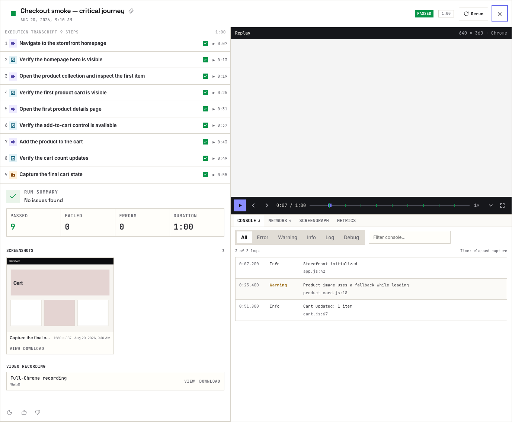

### Running

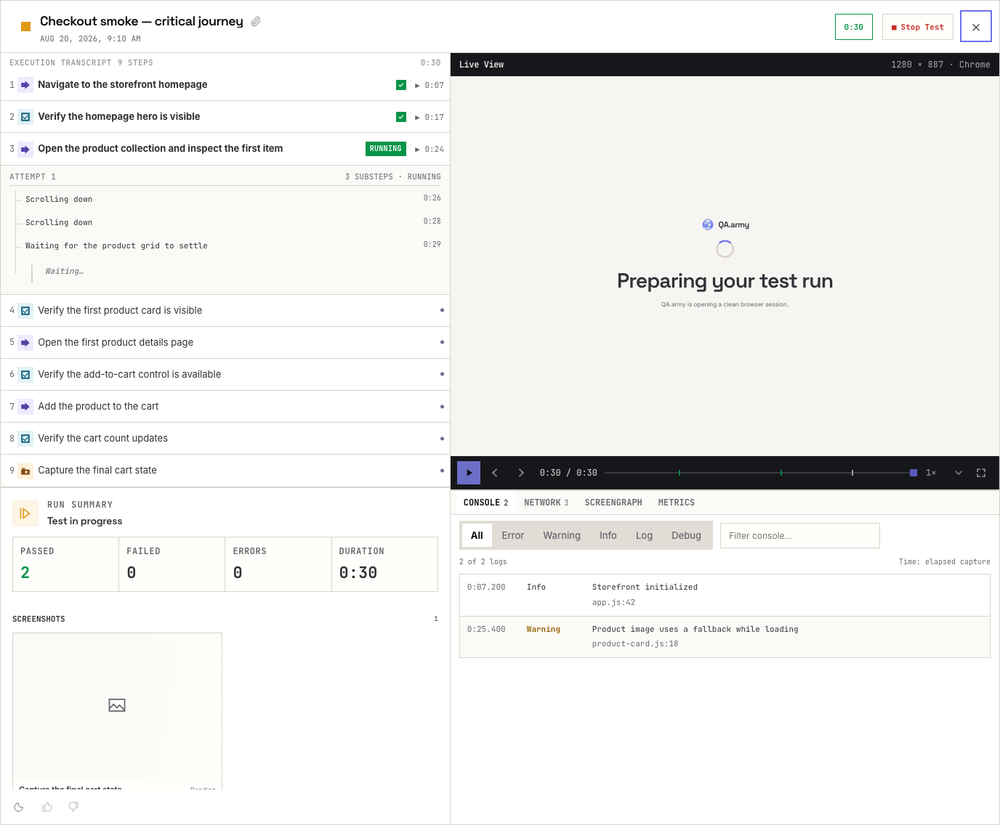

### Failed


### Error

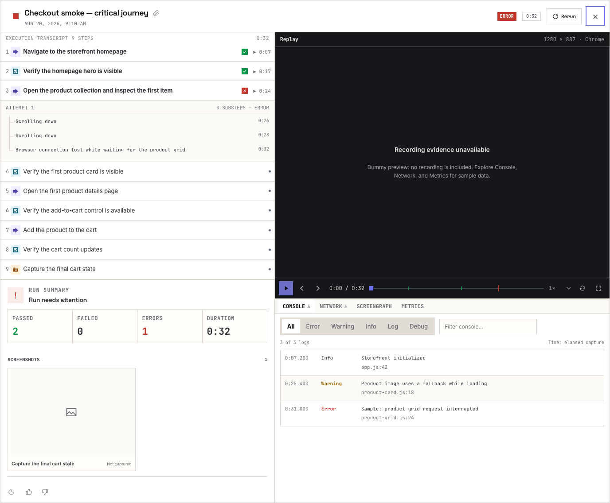

### Ready

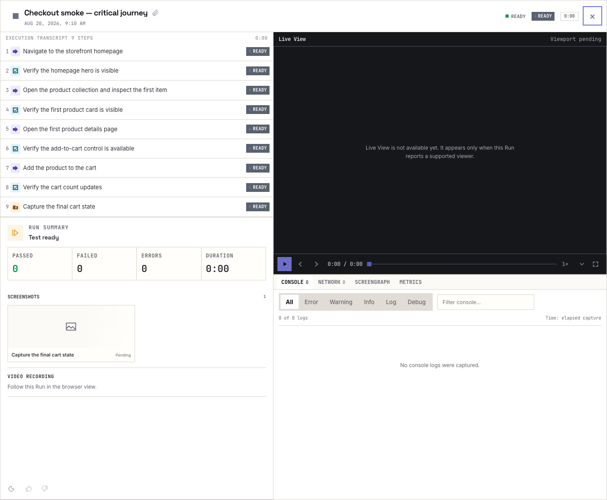

### Unavailable

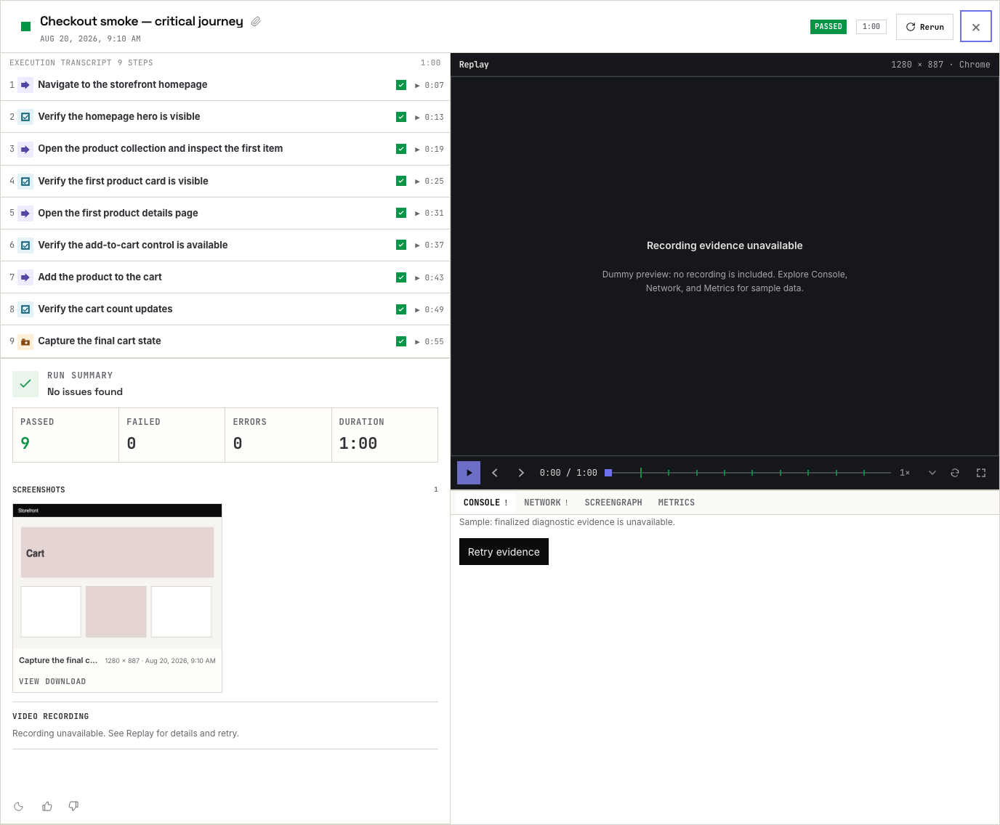

## Mobile

All six Run page states, at phone width.

| Passed | Running | Failed | Error | Ready | Unavailable |
| --- | --- | --- | --- | --- | --- |
| 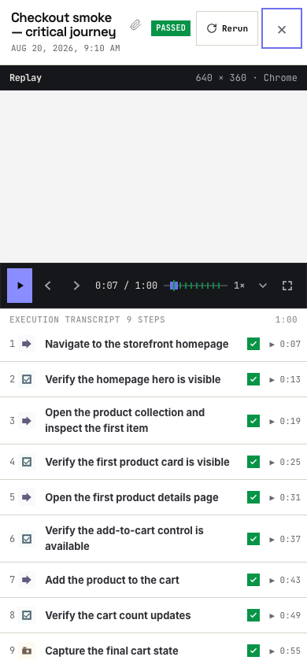 | 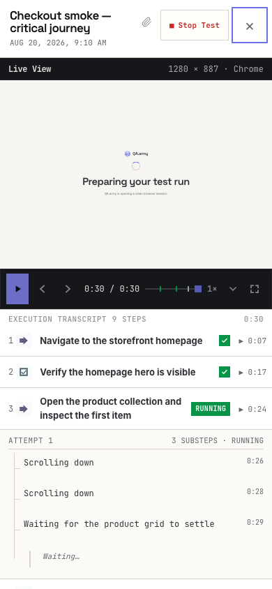 | 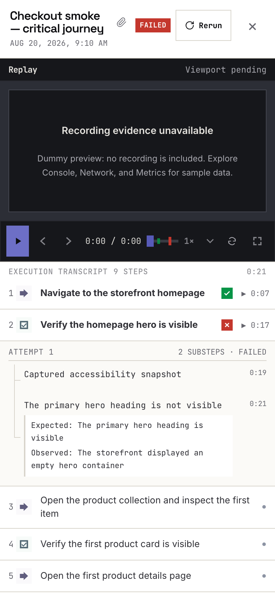 | 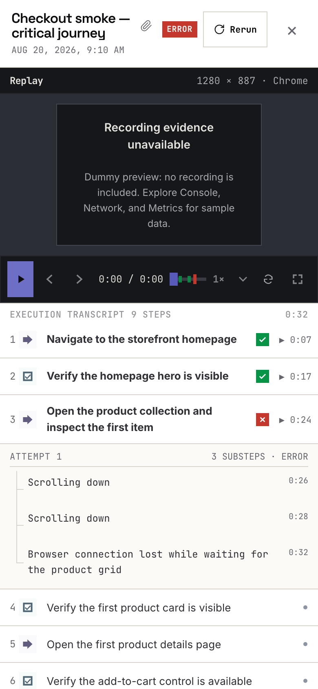 | 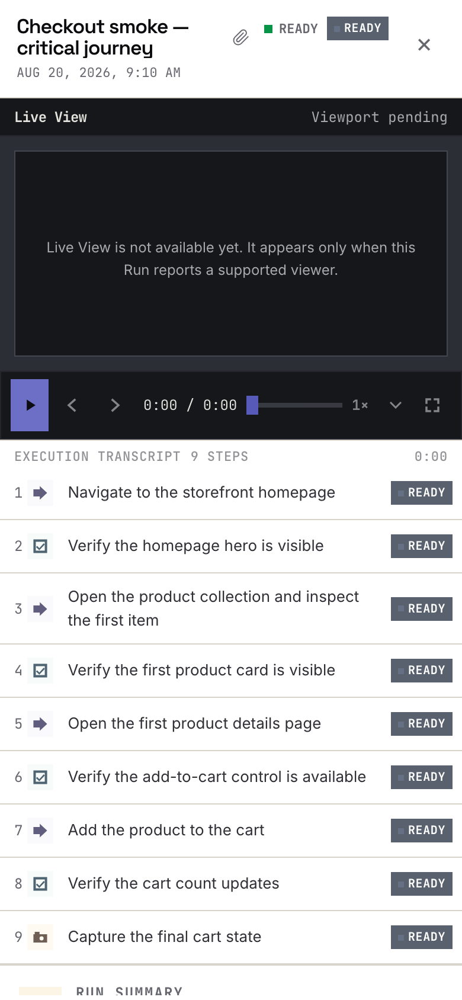 | 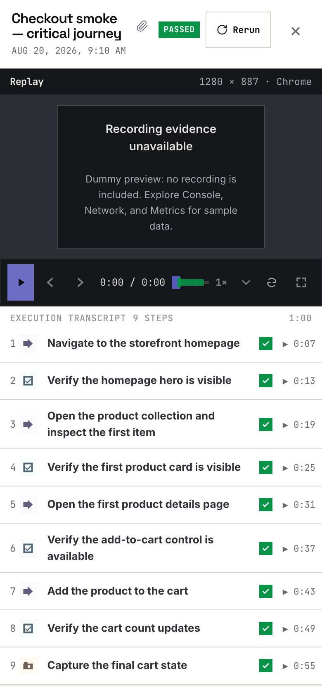 |

## Component gallery

### Status

| Passed | Failed | Error | Ready | Cancelled |
| --- | --- | --- | --- | --- |
|  |  |  |  |  |

### Step types

| Act | Verify | Login | Files |
| --- | --- | --- | --- |
| 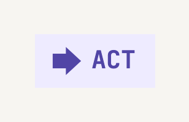 | 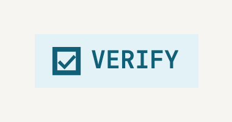 |  | 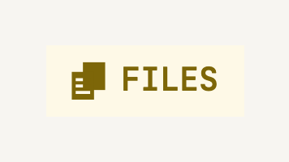 |

| Screenshot | JavaScript | Microphone |
| --- | --- | --- |
| 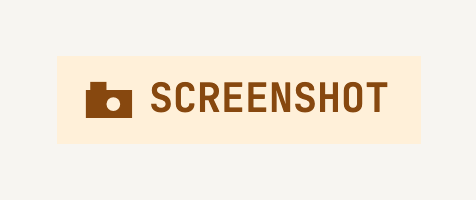 | 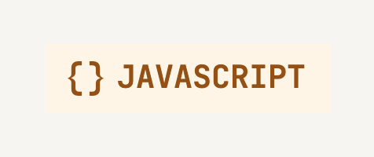 | 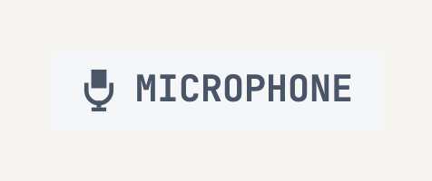 |

### Outcomes

| Passed | Failed | Running | Not started |
| --- | --- | --- | --- |
|  |  |  |  |

### Header

| Passed | Settled time | Rerun |
| --- | --- | --- |
|  | 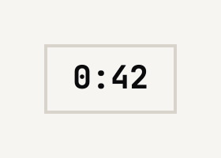 | 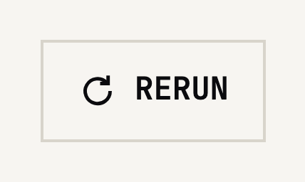 |

| Running | Live time | Stop |
| --- | --- | --- |
|  | 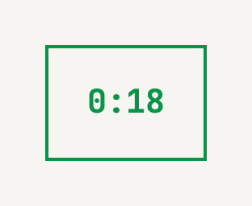 | 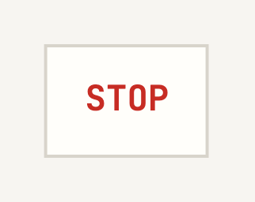 |

### Transcript rows

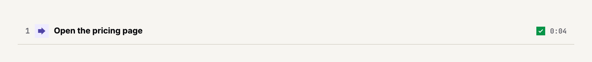

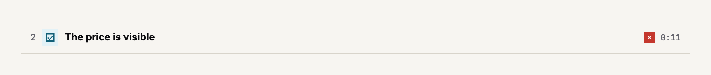

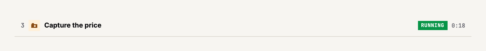

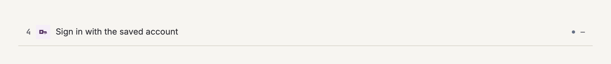

### Playback

| Play | Previous | Next | Time |
| --- | --- | --- | --- |
|  |  |  | 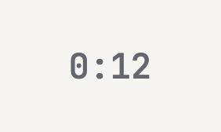 |

| Seek | Speed | Fullscreen |
| --- | --- | --- |
|  | 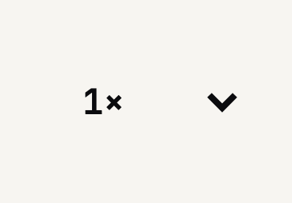 |  |

### Instruction

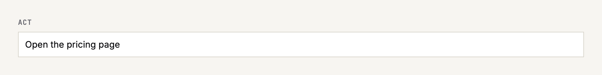

| Save test | Cancel |
| --- | --- |
|  |  |

## Develop

Requires Node.js 22 or newer.

```sh
npm run dev
```

## License

[MIT](LICENSE) © 2026 QA.army
