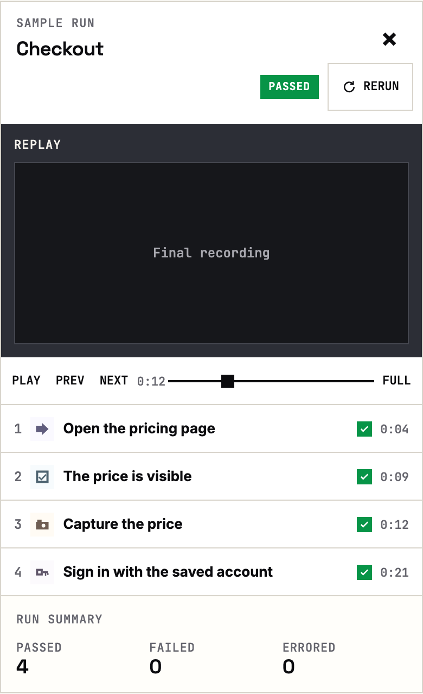
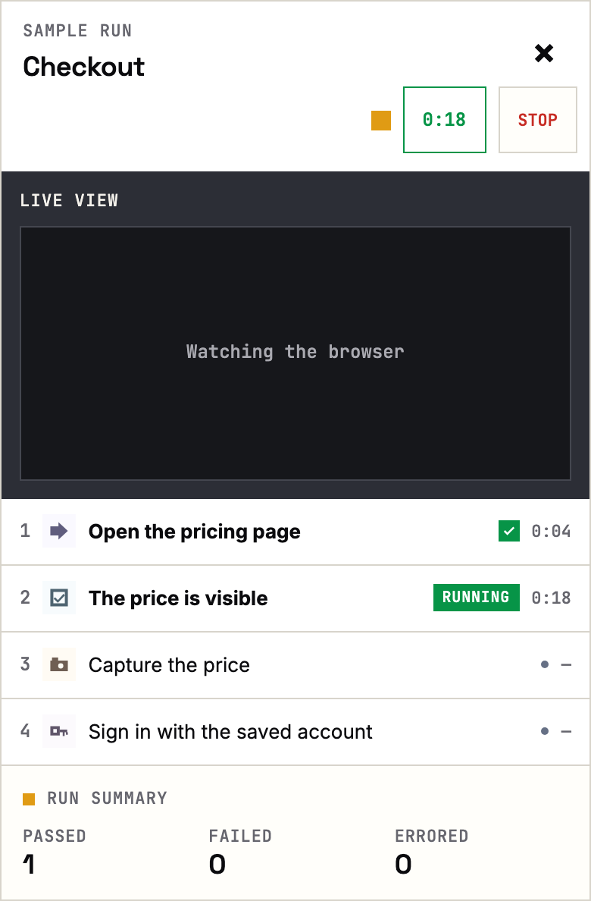
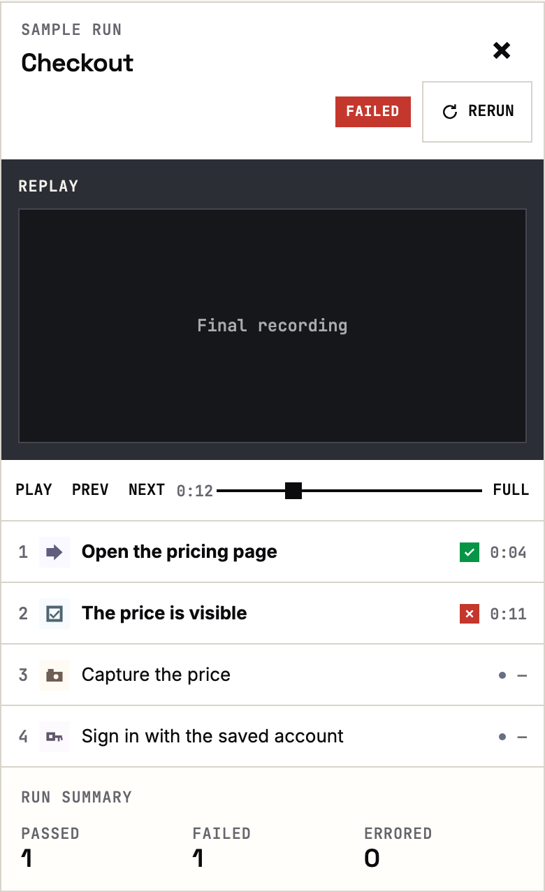
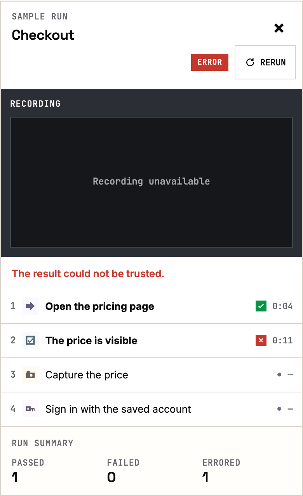

# QA.army UI

The QA.army web UI. Open source under the MIT License.

This repository is the standalone interface for the QA workspace. It is separate from the hosted execution service. The samples below are the workbench components.

## Mobile

Four states at phone width. The recording comes first, then the steps. Console, Network, Screengraph, and Metrics are not on this screen. The outcome sits beside the time.

Passed keeps the recording and Rerun. Running is a live view: the clock and Stop, with no scrubber. Failed is a check that did not hold, and the recording is still there. Error means the result could not be trusted, so the recording is absent.

### Passed



### Running



### Failed



### Error



## Component gallery

### Status

| Passed | Failed | Error | Ready | Cancelled |
| --- | --- | --- | --- | --- |
|  |  |  |  |  |

### Step types

| Act | Verify | Login | Files |
| --- | --- | --- | --- |
|  |  |  |  |

| Screenshot | JavaScript | Microphone |
| --- | --- | --- |
|  |  |  |

### Outcomes

| Passed | Failed | Running | Not started |
| --- | --- | --- | --- |
|  |  |  |  |

### Header

| Passed | Settled time | Rerun |
| --- | --- | --- |
|  |  |  |

| Running | Live time | Stop |
| --- | --- | --- |
|  |  |  |

### Transcript rows


### Playback

| Play | Previous | Next | Time |
| --- | --- | --- | --- |
|  |  |  |  |

| Seek | Speed | Fullscreen |
| --- | --- | --- |
|  |  |  |

### Instruction


| Save test | Cancel |
| --- | --- |
|  |  |

## Adoption

The UI can report that it started, so QA.army can see whether the open interface is being used. A report contains only:

- `event`: `ui_started`
- `version`: the UI version
- `install_id`: a random id created on the first start and kept in local storage
- `surface`: `web`

It does not include an account, Workspace, Test, Run, URL, or anything typed into the product. The browser's Do Not Track setting turns reporting off. Choosing off also deletes the stored install id.

```ts
import { recordAdoption, setTelemetry } from "qa-army-ui";

await recordAdoption({ version: "0.0.1", storage: localStorage });
setTelemetry(localStorage, "off");
```

Reports go to `https://qa.army/api/ui-adoption`. A network failure is ignored and does not affect the interface.

## Develop

Requires Node.js 22 or newer.

```sh
npm test
```

## License

[MIT](LICENSE) © 2026 QA.army
