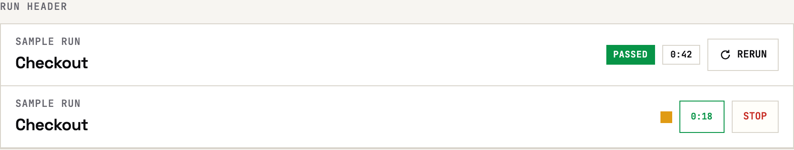
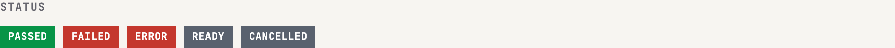
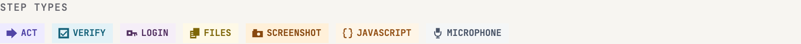
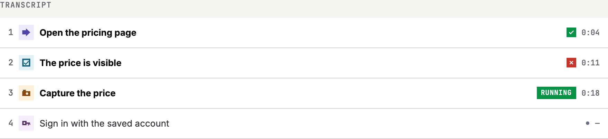
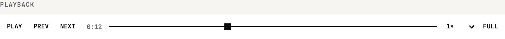
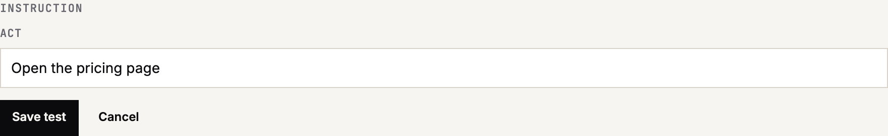

# QA.army UI

The QA.army web UI. Open source under the MIT License.

This repository is the standalone interface for the QA workspace. It is separate from the hosted execution service. The samples below are the workbench components.

## Component gallery

### Run header



### Status



### Step types



### Transcript



### Playback



### Instruction



## Adoption

The UI can report that it started, so QA.army can see whether the open interface is being used. A report contains only:

- `event`: `ui_started`
- `version`: the UI version
- `install_id`: a random id created on the first start and kept in local storage
- `surface`: `web`

It does not include an account, Workspace, Test, Run, URL, or anything typed into the product. The browser's Do Not Track setting turns reporting off. Choosing off also deletes the stored install id.

```ts
import { recordAdoption, setTelemetry } from "qa-army-ui";

await recordAdoption({ version: "0.0.1", storage: localStorage });
setTelemetry(localStorage, "off");
```

Reports go to `https://qa.army/api/ui-adoption`. A network failure is ignored and does not affect the interface.

## Develop

Requires Node.js 22 or newer.

```sh
npm test
```

## License

[MIT](LICENSE) © 2026 QA.army
